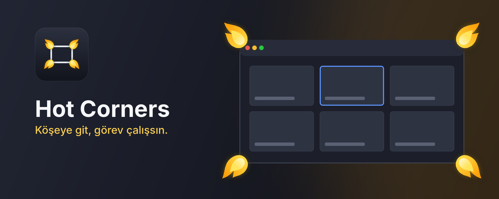

<p align="center">
  
</p>

<h1 align="center">Hot Corners</h1>
<p align="center"><b>Every corner, a shortcut.</b><br>A Chrome extension that turns the four corners of every web page into the actions you use most.</p>

---

You know the moment. Twenty-six tabs are open, each one squeezed down to a sliver with a favicon, and the one you need is somewhere in the middle. You squint. You click the wrong one. You press Ctrl+Tab, overshoot, and go back. A few seconds lost, and it happens again ten minutes later, all day long.

Now picture this instead: you flick the pointer into the top-left corner of the page, and every tab you have spreads out in front of you as a grid of live previews. You see the one you want, click it, and you're there. Flick to the bottom-right corner and you're back on the tab you just left.

No aiming at tiny targets. No shortcut to remember. Every page has four corners that nothing else uses, and Hot Corners puts them to work.

## What a corner can do

Give each corner the job you reach for most. Change it whenever your habits change.

| | Actions |
|---|---|
| **Tabs** | Tab overview · Last used tab · Next / previous tab · New tab · Close tab · Reopen closed tab · Duplicate · Pin · Mute |
| **Page** | Back · Forward · Reload · Scroll to top · Scroll to bottom |
| **Window** | New window · Minimize · Full screen |
| **Your own** | Open any web address you choose, like your inbox, your calendar or today's to-do list |

## The tab overview

This is the one most people never turn off. It shows every tab from every window at once, with a preview of each page, so you recognize tabs by how they look instead of hunting for titles. Start typing to filter. Use the arrow keys and Enter if your hands are on the keyboard. Close tabs right from the grid. Go back to the same corner and it's gone.

You can also open it with **Ctrl+Shift+Space** without going to a corner at all.

## Built so it never gets in your way

A tool that fires by accident gets uninstalled by Friday. Hot Corners was designed around that worry from the start.

- **Hold a key, if you like.** Set any corner to work only while you hold Shift, Ctrl or Alt. Brush past the corner without the key and nothing happens.
- **Tune the trigger.** Choose how long the pointer has to rest in a corner and how big a corner is.
- **Quiet during movies.** When a video or game goes full screen, the corners rest until you're done.
- **One key to switch it all off.** **Ctrl+Shift+H** turns Hot Corners off, and the same key turns it back on. The toolbar icon goes grey, so you always know where you stand.
- **Pause and forget.** Pause for 15 minutes, an hour, or until Chrome restarts. It comes back on by itself.
- **Leave some sites alone.** Exclude any site with one click from the toolbar icon. Your design tool or online game keeps its corners.
- **Quick controls on right-click.** Right-click the toolbar icon to turn it off, pause, or exclude the current site.

## Your browsing stays yours

Hot Corners collects nothing and sends nothing anywhere. There are no accounts, no analytics and no ads. Your settings live in your own Chrome profile, and tab previews stay in memory only until the session ends. The full [privacy policy](store/privacy.html) is short and in plain English.

## Get started

Hot Corners isn't on the Chrome Web Store yet. Until then, installing it takes about a minute:

1. Download this repository (**Code → Download ZIP**) and unzip it.
2. Open `chrome://extensions` and turn on **Developer mode** in the top-right corner.
3. Click **Load unpacked** and choose the `extension` folder.
4. Pin Hot Corners from Chrome's puzzle-piece menu so its icon stays in view.

A short welcome card opens with the defaults: the **top-left** corner opens the tab overview and the **bottom-right** corner takes you back to your last tab. Try them, then make the corners your own.

## Good to know

- **The corners are the corners of the page,** below the tab bar. With the window maximized, the left corners line up with the edge of your screen, so they're quick to hit. In full screen (F11), all four match the corners of your screen.
- **Chrome keeps its own pages off-limits.** Extensions can't run on the New Tab page, Chrome's settings or the Web Store, so corners rest there.
- **Previews appear as you browse.** A tab gets its preview the first time you look at it; until then it shows the site's icon.

---

## For developers

### Repository layout

| Folder | Contents |
|---|---|
| `extension/` | The extension itself (Manifest V3, no dependencies, no build step). |
| `store/` | Store images, the store listing text (`STORE-LISTING.md`) and the privacy policy page. |
| `tools/` | Icon and promo image generator, packaging script and logic tests. |

### Common tasks

```bash
node tools/test-corners.js      # corner detection, hold-a-key, delay, full screen
node tools/test-background.js   # on/off, pause, toolbar icon state, right-click menu
python3 tools/draw_icons.py     # redraw icons and store images (Pillow + NumPy)
./tools/package.sh              # build dist/hot-corners-<version>.zip for the store
```

The tests run on plain Node 18+ with Chrome's APIs stubbed out. After changing code, press the reload icon on the extension card in `chrome://extensions` and reload any open tabs. Raise `version` in `extension/manifest.json` for every release.

### How it fits together

- **`content.js`** runs on each page. It watches whether the pointer is in a corner, draws the tab overview inside a Shadow DOM so page styles can't touch it, and shows status notices.
- **`background.js`** carries out tab and window actions, captures previews, and handles keyboard shortcuts, pausing, the toolbar icon state and the right-click menu.
- **`shared.js`** holds the action list, default settings and settings helpers.
- **`popup.*`** is the toolbar popup, **`options.*`** the full settings page, and **`ui.*`** the parts they share.
- Settings live in `chrome.storage.sync`, the pause state in `chrome.storage.local` and previews in `chrome.storage.session`. Nothing leaves the browser.

---

<p align="center"><b>Four corners. Zero clicks. Pick what yours will do.</b></p>
